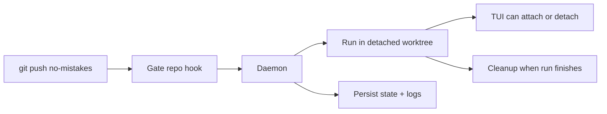

The daemon is a long-running background process that manages pipeline runs. The
installer prefers setting it up as a managed background service, and
`no-mistakes`, `init`, `attach`, `rerun`, and `update` keep that service
installed and running for you when that path is available.

## Why a daemon exists

The daemon exists so `git push no-mistakes` stays fast and the gate can keep
working after your shell command returns.

- Git hands the push to the local gate repo.
- The hook notifies the daemon and returns after the admission response.
- The daemon owns the long-running work: worktrees, pipeline execution, TUI
  events, state, cleanup, and crash recovery.



On macOS this is a per-user `launchd` agent, on Linux a per-user `systemd` service, and on Windows a Task Scheduler task. The installed artifact names are scoped by `NM_HOME` with a short stable suffix, so the paths and service identifiers look like `~/Library/LaunchAgents/com.kunchenguid.no-mistakes.daemon.<suffix>.plist`, `~/.config/systemd/user/no-mistakes-daemon-<suffix>.service`, and the Windows task `no-mistakes-daemon-<suffix>`. That keeps multiple `no-mistakes` installs from colliding when they use different `NM_HOME` roots. Those service managers keep the daemon available across CLI invocations and restart it after `no-mistakes update` replaces the binary. A managed service starts with a minimal environment, so at daemon startup it resolves `PATH` and proxy variables from your login shell and the baked-in service definition; [Environment the daemon sees](/no-mistakes/reference/environment/#environment-the-daemon-sees) owns that resolution story. Restart the daemon after changing those values. If managed service install or startup is unavailable or fails, `no-mistakes` falls back to starting a detached daemon process instead.

## Starting and stopping

Most people do not need to manage the daemon directly. The usual commands
already make sure it exists when needed.

```sh
# Explicit management
no-mistakes daemon start
no-mistakes daemon stop
no-mistakes daemon uninstall
no-mistakes daemon restart
no-mistakes daemon status

# Ensures the daemon is running, using the managed service when possible
no-mistakes
no-mistakes init
no-mistakes attach
no-mistakes rerun
no-mistakes axi run
no-mistakes axi respond

# Resets the daemon after replacing the binary
no-mistakes update
```

`no-mistakes update` stops and starts the daemon when it is running, or when stale daemon artifacts exist, so the new executable is used.
It prefers the managed service path and falls back to a detached daemon if service startup is unavailable or fails.
If pending or running pipeline runs exist, `update` refuses to restart the daemon by default and prints each active run's ID, status, branch, and short head SHA. Pass `--force` to restart the daemon anyway and accept that those runs may fail; `-y`/`--yes` does not bypass this guard.
If the daemon is already running from a different executable path, update still prompts before replacing it; `-y`/`--yes` answers that prompt non-interactively.
If the daemon executable path cannot be determined, the update aborts before replacing anything.

`no-mistakes daemon stop`, `no-mistakes daemon uninstall`, and `no-mistakes daemon restart` apply the same guard: if pending or running pipeline runs exist, each refuses by default and lists the active runs, and each takes its own `--force` to proceed anyway.
`no-mistakes daemon start` applies it when it would restart a running daemon to refresh a changed service definition or replace an older daemon that does not support the gate-context RPC; it then refuses before stopping the daemon or rewriting the definition, and takes `--force` the same way.
When a running daemon does not support that RPC, `daemon start`, `daemon stop`, `daemon restart`, `daemon uninstall`, and `update` check gate execution context locally, including process ancestry, and still refuse callers inside validation steps. `daemon start` then stops the older daemon and installs the current binary in the managed service definition before starting it, as `daemon restart` does.
That `--force` override is available only to an ordinary top-level caller. A
process descended from an active validation-step agent cannot start, stop,
restart, uninstall, or update the daemon, or change its scheduling settings with
`daemon set`. Recursive containment refuses the command before any lifecycle
or config mutation, with no `--force` or `--yes` bypass.
Every invocation of `daemon stop`, `daemon uninstall`, `daemon restart`, or `update`, and every `daemon start` that would restart a running daemon - forced or not - logs the caller's PID, parent PID, and parent command line to `~/.no-mistakes/logs/cli.log` so a later incident can identify which agent or process triggered it.

The daemon writes an identity record to `~/.no-mistakes/daemon.pid` and listens on a Unix socket at `~/.no-mistakes/socket`. On Windows, it uses a localhost TCP listener and a protected endpoint file at the same path. CLI clients bound how long they wait for that socket to accept a connection with [`daemon_connect_timeout`](/no-mistakes/reference/global-config/#daemon_connect_timeout), so a daemon process that is alive but stuck fails the connection instead of hanging the caller; see [Troubleshooting](/no-mistakes/guides/troubleshooting/#check-for-stale-artifacts). After connecting, daemon status and readiness probes allow a separate five seconds for the health reply, so a slow but responsive daemon remains healthy. A health-reply timeout makes commands that ensure the daemon is running fail without starting a replacement; explicit `daemon start` still attempts startup after a health error.
When the socket file exists but refuses connections and the PID file names a daemon that is provably gone (its process no longer exists, or its start time no longer matches), every status probe treats the daemon as not running and removes the stale socket and PID file, so `daemon status` reports `daemon not running` and `update` goes on to start the new daemon. The removal happens only while holding the singleton lock and only if the PID file is unchanged, so it never touches a daemon that is starting up. A live or unverifiable recorded PID leaves both files in place, and commands that ensure the daemon is running (`no-mistakes`, `init`, `attach`, `rerun`, `axi run`, `axi respond`) then fail fast rather than silently starting a replacement daemon; `no-mistakes daemon start` self-heals past that case.
After accepting a shutdown request, `daemon stop` verifies that the captured daemon process has exited before returning success; socket health alone cannot prove exit. The [shutdown protocol](#crash-recovery) owns identity verification and safe supervisor and artifact cleanup. A daemon draining many runs may exit during process inspection after the stop timeout. When the process and endpoint are confirmed gone, stop succeeds even if its PID file has already been removed; stale artifacts are cleared only under the singleton lock. A known successor is left untouched.

`daemon restart` normally waits for that successful stop before starting the replacement. If stopping returns an error, restart checks health: when the old daemon is confirmed no longer answering, it prints the stop error as a warning and attempts startup. The singleton lock still prevents a second daemon from owning the root if the old process remains alive. If the old daemon still answers or the health check returns an error, restart fails with the stop error, says the old daemon may still be running, and starts nothing.

Process launch and daemon readiness are separate states. After taking the singleton lock, the daemon publishes its PID before exclusive crash recovery begins, but startup is not successful until the IPC server returns a real health response. `daemon start` allows up to 45 seconds for cold environment setup and recovery, reports a child that exits before readiness promptly, and never treats the PID file or a bound socket as proof that the daemon is ready. Each readiness connection attempt, health-reply wait, and poll sleep is capped by the remaining startup budget; ordinary status checks retain the configured connection bound. If detached startup times out, the command kills and reaps that child before returning; if managed startup fails, it cleans up the managed attempt before trying the detached fallback and preserves both errors when both paths fail.

Only one live daemon can own an `NM_HOME` at a time.
At startup - before crash recovery runs and before the socket is bound - the daemon takes an exclusive OS file lock on `~/.no-mistakes/daemon.lock` and holds it for the life of the process.
A second daemon started against the same root fails with "a no-mistakes daemon is already running for this NM_HOME" (with the holder's PID and start time when available) instead of stealing the first daemon's socket and running crash recovery against its live runs.
The OS releases the lock automatically when the owning process exits or crashes, even on SIGKILL, so unlike the PID file the lock can never go stale.
As an independent safety layer, the daemon also refuses to bind the Unix socket while something is still answering on it; only a provably stale socket file (nothing listening) is removed and rebound.

## What it does

When a push arrives via the post-receive hook, the daemon records the run. If
no execution slot is available, it queues the run durably without creating a
worktree or executor. Once admitted, it:

1. Creates a detached worktree at `~/.no-mistakes/worktrees/<repoID>/<runID>/`, or in a configured root; [`worktree_roots`](/no-mistakes/reference/global-config/#worktree_roots) owns placement and when it becomes fixed for a run
2. Starts the pipeline executor in that worktree
3. Streams events to any connected TUI clients and serves request/response state to AXI clients
4. Cleans up the worktree when the run finishes (success or failure), subject to the retention rules below

An unresolved [`protected_paths`](/no-mistakes/reference/repo-config/#protected_paths) refusal preserves the index and working files across daemon shutdown, cancellation by a newer push, and crash recovery, including when trusted-config loading fails and the run cannot resume. This retention does not weaken recovery validation or keep a terminal run active: orphan-process cleanup and test-evidence expiry still apply. Successful completion of the refused step releases this protection; deliberate operator skip and abort retain their existing cleanup behavior.

A failed Document step also preserves its index and working files through terminal cleanup, retention reaping, and startup cleanup, even without a protected-path finding. This protects work left by a failed [Document entry or rollback check](/no-mistakes/reference/repo-config/#documentmax_commits_per_run). Explicit operator abort permits cleanup; this protection does not retain processes or extend test-evidence retention.

Step 4's cleanup is best effort: a `git worktree remove` failure (for example a vendored `.git` nested somewhere under a large `node_modules` tree) leaves the directory behind rather than retrying immediately. The [`worktree` retention setting](/no-mistakes/reference/global-config/#worktree) is the safety net for that leftover - it reaps eligible directories under the default tree after every finished run and again at startup, so a long-lived daemon converges on the retention budget instead of waiting for the crash-recovery sweep below, which only ever runs once per restart.

Event delivery is bounded, so a slow or wedged client can never stall a run. Under pressure the daemon may drop ordinary log output, but it never silently loses a state change: it coalesces those into a single gap signal, and the TUI and `axi` respond by re-reading authoritative run state. A live view can therefore skip log lines while it is behind, but it converges on the run's real state. After a dropped connection, the TUI retries with a bounded delay and reconciles when it reattaches; if the daemon remains unavailable, it surfaces the connection error instead of retrying forever.

Pipeline agents are prompted to keep intentional writes inside that detached worktree and avoid changing system state outside it, such as Homebrew packages, apps under `/Applications`, or global tool configuration.
That reduces surprising machine-level side effects and macOS App Management prompts, but it is prompt steering rather than a true sandbox.
While executing steps, the daemon also owns child-process cleanup.
Configured commands and one-shot agent subprocesses are terminated as a process tree on completion, failure, or cancellation so leaked test workers, build watchers, or dev servers cannot accumulate across runs.
Each process is asked to exit first and only forcibly killed if it is still running a few seconds later.
A process can still escape that tree by detaching itself into its own session, so when a run finishes the daemon also terminates anything still standing in that run's worktree before removing the directory.
That sweep is scoped by working directory: it never touches a worktree whose run is still active, and it can never reach a process working outside `~/.no-mistakes/worktrees/` or outside a run worktree a run record names in a configured worktree root.

On Linux, a step that exhausts memory fails only its own run.
Configured commands, agent subprocesses, and managed agent servers raise their `oom_score_adj` so the kernel OOM killer picks them before the daemon.
The generated systemd unit sets `OOMPolicy=continue`, so one killed step no longer stops the whole service and interrupts other in-flight runs. [Crash recovery](#crash-recovery) owns how interrupted runs are handled.
When a step process is killed and the daemon's cgroup records a new `oom_kill`, the step fails with "ran out of memory" appended to its original error text, and the step log keeps the command output printed before the kill.
An existing unit picks up the policy when `no-mistakes daemon start` or `restart` refreshes the service definition.

## Concurrent push handling

When a push requires a new validation on a branch with active work, the daemon:

1. Validates the receive and launch options, capturing the branch's predecessors
2. Commits the replacement run, any owner-admission event, and its notification binding together
3. Cancels only the captured predecessors (reason: "cancelled: superseded by new push") and waits for their workloads to stop
4. Submits the replacement for slot admission

Pre-commit validation, configuration, or insertion failures preserve the active predecessors. If cancellation or admission fails after the commit, the replacement is settled through setup-failure handling and the error names the failed operation. Receive retention, predecessor capture, and admission share the repository/branch lock. See [retained-notification recovery](/no-mistakes/reference/cli/#launch-owner) for replay and failed-setup handling.

Receipt lookup, admission validation, and claim take that same branch lock, so claims wait for admission to finish before judging a pending run's ownership. Run eligibility validation and first-observer marker consumption also commit in one database transaction: the branch lock alone does not serialize pipeline failure writes. A rejected claim rolls back the marker, preserving the once-only `created` disposition. These checks apply to receipt claims and both new and replayed fresh RPC launches; see [strict launch receipts](/no-mistakes/reference/cli/#strict-launch-receipts) for eligibility and request matching.

Pushes to different branches share execution slots. A newer push to a branch whose run is still queued supersedes it without starting it. The control plane (`status`, `respond`, `abort`, `gate_context`, launch) never waits on a slot. An IPC `respond` request with `action: abort` needs no gate identity. At a parked, waiting gate it fails the run with the gate's existing `aborted by user` error and failure reporting. If a response is already accepted and waiting for capacity, or recovery has not dispatched the run, it uses the same cancellation path as `axi abort --run`. Once cancellation stops the workload, the run is `cancelled`, its saved pending response is cleared, and its slot or reservation is released. A restart cannot replay that response.

Abort and supersede share one cancellation path that consults an in-memory ownership table, under one lock, before the database. Each live run is in exactly one state:

| State | What abort or supersede does |
| --- | --- |
| Queued | Saves the cancellation first and removes the queue entry only on success. A database write failure returns the error and leaves the run queued in place, still abortable. |
| Claimed (launching or executing) | Invokes the run's cancel handle immediately, with no database access before it, so a failing database cannot keep a run alive. The run stays non-terminal until its workload stops; execution and setup exit paths then save the terminal outcome without overwriting an already terminal run. |
| Recovering gate (a parked gate restored after a restart) | Cancels without needing a slot. Recovered gates register their response controls and cancel handle before they wait for capacity, so an abort stops a gate that is still waiting. |
| Finishing (the pipeline has returned; cleanup and result collection remain) | Does nothing. The outcome is decided, so an abort racing completion leaves a `completed` run completed, and a new push neither cancels nor waits for a finishing run. |

Supersession waits for the workload whose cancel handle it actually signalled, including when a queued run was claimed for launch just before cancellation. An abort or supersession during launch setup records `cancelled` with its cancellation reason only when the setup error comes entirely from that cancellation. Independent setup failures, including panics and configuration or read errors, remain `failed` with their original error even when cancellation or shutdown races their settlement. Neither outcome overwrites an already terminal run. Subscribers receive the saved status and reason. A queued run whose saved launch spec cannot be read fails with a `read queued run spec` error instead of starting without it. [Crash recovery](#crash-recovery) owns admission of recovered gates.

The [step-status contract](/no-mistakes/reference/pipeline-steps/#step-statuses) owns durable response acceptance, answered-gate presentation, and parked-time accounting while waiting for capacity.

The global [`daemon` configuration](/no-mistakes/reference/global-config/#daemon) owns the limits, queue ordering, slot release rules, and hot reload behavior. The [CLI reference](/no-mistakes/reference/cli/#no-mistakes-daemon-set-max-concurrent-runs) explains changing the cap with `daemon set`; [`axi` status output](/no-mistakes/reference/cli/#no-mistakes-axi) and [`doctor`](/no-mistakes/reference/cli/#no-mistakes-doctor) report usage.

This is another reason the daemon exists: branch-level coordination is easier to
reason about in one long-lived process than inside independent hook invocations.

## Database write contention

The daemon, pipeline, and local eval storage keep SQLite's five-second busy timeout and retry busy or locked writes, including extended `SQLITE_BUSY_SNAPSHOT` errors, with jitter for a 30-second retry budget. Retry waits honor the supplied context's cancellation. A final in-flight busy handler can take up to another five seconds. The retry budget does not cut off an uninterrupted startup schema upgrade. Whole read/write transactions restart from a fresh snapshot; agent turns, Git operations, and forge operations are never replayed by this retry.

An exhausted write returns the typed `SQLITE_WRITE_CONTENTION` infrastructure error with the operation, attempt count, and underlying cause. The cause can be a connection-wait deadline or deadline-triggered transaction rollback even when no SQLite busy or locked error was observed. The affected run stops. When terminal persistence succeeds, the run and its active steps use `failed` for status compatibility, with the named infrastructure error; clearing the parked marker and settling elapsed parked time happen in the same transaction. The existing published-head forge status is preserved without a new status post, so its conclusion and description remain unchanged. The named lock error appears in the run error and daemon log. A genuine command failure remains a code failure even if its output mentions `SQLITE_WRITE_CONTENTION`. Inspect the daemon log, release the database lock, and rerun the affected branch when ready.

The daemon also writes a small record under `<NM_HOME>/infrastructure-failures/<runID>.json`, syncing its file before replacement so restart status reporting avoids a false code verdict even if SQLite could not save the terminal outcome. On POSIX, replacement is atomic: the daemon syncs `NM_HOME` to publish the marker directory before writing the record, and syncs the marker directory after replacement or deletion. On Windows, file data is flushed, but directory metadata is not explicitly flushed because Go's read-only directory handles do not support that operation; power-loss durability of directory creation, replacement, and deletion is not guaranteed. File and directory open, write, replacement, removal, and supported sync errors are propagated. The record protects status reporting; it does not restore a terminal outcome missing from SQLite. These records are outside log and evidence retention. A new execution of the same run clears its record; a new run has its own identity. Keep these files with database backups. An unreadable or invalid record suppresses the failure-status post and logs `SQLITE_INFRASTRUCTURE_RECORD_UNREADABLE` or `SQLITE_INFRASTRUCTURE_RECORD_INVALID`. If both SQLite and this independent record are unwritable, the daemon reports `SQLITE_INFRASTRUCTURE_RECORD_FAILED`; without either durable outcome, restart cannot reliably distinguish the infrastructure failure from an ordinary interrupted run. Repair storage before restarting or retrying recovery.

## Crash recovery

At startup, the daemon checks every registered gate's branch refs against exact repository, branch and head evidence in run records and valid retained push notifications. An uncovered head is reported as `STARTUP_ORPHANED_REF`, including when a crash happened before the first notification rename and no run exists. The report identifies the repository, ref and commit in the daemon log and `<NM_HOME>/logs/ref-reconciliation.jsonl`. The event log uses the daemon lifecycle log's size and backup bounds. A scan or metadata read failure is named `STARTUP_RECONCILIATION_FAILED`; failure to write the event log refuses startup.

Both `status` and `axi status` recheck current refs and show these diagnostics, even while the daemon is stopped. Recording a matching run, retaining a valid notification, or removing the ref clears the current diagnostic; the startup event remains in log retention. Seeded default branches are checked too, since an initial seed cannot be distinguished safely from a lost receive without durable evidence. Remote-tracking, tag/archive and internal recovery refs are not pipeline submissions.

Reconciliation reports an orphan rather than guessing missing receive options, intent or launch ownership. Preserve the named ref and explicitly submit validation with the intended options. Recognizing a retained notification as evidence does not modify it or authorize admission; reconciliation supplies neither notification persistence nor replay. It checks current branch heads and cannot reconstruct every intermediate or repeated identical receive. A running daemon picks up this startup behavior after a restart, subject to the [active-run lifecycle guard](#starting-and-stopping).

A daemon shutdown leaves a run that is fully recorded as waiting at an approval gate available for the next start to resume at that gate. This also preserves a recovered gate interrupted before dispatch, including during slot admission, comparison checks, or pending reconciliation retries: its parked state, any accepted response, and worktree remain available for the next restart. A run monitoring CI for an already-created PR is normally left for startup recovery as `ci_monitor_interrupted` (see below). A planned shutdown instead records an eligible certified watcher as cancelled under the [success-preservation exception](/no-mistakes/reference/pipeline-steps/#push). Other executing runs record `cancelled` with `cancelled: planned daemon shutdown` on a planned stop, or `failed` with `daemon shutting down` on raw shutdown such as `SIGTERM`; an independent failure retains its own failure outcome.

Startup captures one cutoff before taking the exclusive root lock. While holding that lock and before serving requests, it removes only regular `.notification-<digits>` journal temporary files with mtime strictly older than the cutoff; equal/newer files, symlinks, directories, and final notification files (including corrupt records) are preserved. An invalid journal directory or a filesystem failure stops startup with a named cleanup error.

On startup, the daemon checks for interrupted `pending` or `running` runs and restores the durable queue:

- Never certifies a run from a stored `merged` or `closed` observation alone; current comparison and support evidence must pass before completion
- Resumes only fully recorded parked approval gates whose worktree and step history can be validated; incomplete or ambiguous active runs fail closed
- Replays a saved pending response after admission without requiring another response, subject to the [gate-identity requirements](/no-mistakes/reference/cli/#no-mistakes-axi-status). A pending reconciliation claim instead re-checks the external state: transient read failures preserve the pending record and retry at `gate_reconcile_interval`, releasing the slot between attempts by default; fatal reconciliation errors fail the run. The [step-status contract](/no-mistakes/reference/pipeline-steps/#step-statuses) owns pending-record cleanup and parked-time accounting on dispatch, cancellation, and recovery errors
- Rebuilds a parked run with the repository gate list pinned in `runs.gates_json` when that run started, never the current default-branch list. An absent pin on an older run means the core pipeline, while an invalid pin refuses recovery
- Re-resolves and validates any configured repository forge profile before rebuilding the recovered run, so resumed provider checks and agents use the same repository-scoped identity model rather than persisted credentials or ambient active accounts
- Before resuming a parked CI gate, validates its recorded PR URL and comparison through the configured provider. A missing run URL or mismatched identity fails the recovered run and CI step at the PR comparison guard, before CI reconciliation can record a PR state. A URL stored only in the comparison receipt does not supply the missing run identity. An eligible gate with a currently merged or closed PR returns to CI execution under the [CI completion rules](/no-mistakes/reference/pipeline-steps/#ci), while an open, unknown, or unreachable PR remains parked. A gate carrying unresolved or supported Review CI claims cannot be released by a terminal observation alone. The [`protected_paths` refusal exception](/no-mistakes/reference/repo-config/#protected_paths) prevents automatic reconciliation
- Preserves a run that was actively monitoring CI for an already-created PR as `ci_monitor_interrupted` rather than failing it: the run has no final verified verdict, so a restart mid-monitor is not a code failure. That run is terminal and never resumed
- Before failing any other stale active run, verifies its managed worktree head and pins an unpublished descendant under the run-specific recovery ref so later rerun or guarded custody recovery does not fall back to a stale gate branch
- Marks every other stale active run as `failed` with the message "daemon crashed during execution"
- Reads and validates every `queued` row first, before any other recovery step and without changing anything; if that read fails, startup fails with a `restore queued runs` error and parked gates are left parked for the next start rather than resumed and then cancelled. Queue order is stored as a `queued_at` stamp that never goes backwards, whatever the wall clock does
- Registers `queued` runs with the scheduler but starts none of them, and starts no config watcher, until IPC has bound and answered health; a startup that fails earlier (for example the IPC bind) leaves every queued row queued for the next start. The limits from the validated startup config stay in force if `config.yaml` later goes missing or unreadable
- Leaves `queued` runs queued (nothing about them was running) and starts them first in, first out as capacity becomes available. Recovered runs acquire slots in recovery order ahead of queued new runs, without exceeding `daemon.max_concurrent_runs`. With `daemon.hold_slot_while_parked: true`, recovered parked runs retain admitted slots; the rest wait in priority order
- Reaps orphaned managed agent servers left behind by a crashed daemon or setup wizard
- Terminates processes a crashed daemon left running in worktrees no run owns any more, using the same working-directory scoping as run cleanup plus a ten-minute age floor so a run starting concurrently with startup is never mistaken for a leak
- Removes orphaned worktree directories via `git worktree remove --force` - but never one whose run is still `queued`, `pending`, or `running`, or whose unresolved refusal requires [retention](#what-it-does); under `~/.no-mistakes/worktrees/` that means eligible leftovers from terminal runs plus directories with no matching run record, while in a [configured worktree root](/no-mistakes/reference/global-config/#worktree_roots) only the directories run records name are ever swept or removed. A `ci_monitor_interrupted` worktree is also kept when its checked-out commit differs from the run's last pushed commit, since it may still hold an unpushed CI auto-fix commit
- Migrates gates named by authoritative repository records, plus legacy directories with the strict `<repoID>.git` shape. Before changing an unstamped candidate, it validates that the directory is a bare repository without relying on the current directory or ancestor Git discovery; unrelated and malformed directories are rejected without hook or Git mutation
- For a validated legacy gate, installs or refreshes the no-mistakes-managed pre-receive admission and post-receive notification hooks, preserving an existing custom pre-receive hook behind the admission wrapper, then enables push-option support and reapplies per-worktree hook-path isolation
- Records a content-versioned gate configuration stamp only after the whole migration succeeds. Normal restarts check current stamped gates from the filesystem without rerunning the mutating Git commands
- Clears any parked-awaiting-agent marker so a recovered failed run is not shown as still waiting for `axi respond`

Failed raw-shutdown supersession, terminal writes, terminal readback, and release of shutdown records for runs left for recovery share one publication queue with an owned retry continuation. Failed work stays queued; executors retain custody until settlement completes, and readback retries do not repeat a committed terminal write. Daemon teardown and database closure wait for ordinary and recovered run settlement, including releases for recovery, without a drain timeout. Recovery checks again at one-second intervals with a bounded publication-lock attempt, processing raw supersession before terminal decisions. Database writes use the [shared contention policy](#database-write-contention). Healthy storage therefore lets settlement, notification, and cleanup finish without another request. If the database is closed independently, retries of terminal writes, readbacks, and releases for recovery on that handle end with an explicit error and retained manager custody; failed raw-supersession work remains queued on its original handle. Process loss discards this continuation: startup invalidates unfinished proof and settles obsolete shutdown intent rather than treating it as authority. A `ci_monitor_interrupted` run retains its display state while its status ledger and outbound reporting reconcile to failure.

Local recovery completes before IPC opens. Reconciliation of [GitHub commit statuses](/no-mistakes/reference/pipeline-steps/#push) starts in the background only after IPC health succeeds, so slow status endpoints do not delay readiness. Recovery also scans completed, failed, cancelled, and `ci_monitor_interrupted` runs with unfinished publication attempts or final status updates. This closes a crash gap between saving a terminal run and posting its final status. All recovery status reporting shares one 60-second deadline; each post is limited to 15 seconds or the remaining overall budget, whichever is shorter. Shutdown cancels and waits for that background reporter.

For current runtimes, planned stop, uninstall, and managed-service refresh require the captured PID, process start time, and runtime identity, record an instance-bound shutdown reason before cancelling runs, and acknowledge only after durable terminal outcomes settle or runs are durably released for recovery. The client verifies the complete acknowledgement against its capture. If preparation reaches its deadline before setup or runs settle, admission stays blocked. A later request with the same captured instance resumes the original shutdown lifecycle and rechecks its durable outcomes before acknowledging; it never uses the unfinished intent as crash-recovery proof. The client closes its shutdown connection before waiting for the captured process to exit. Supervisor cleanup then holds the singleton lock through identity rechecks, service disablement, artifact cleanup, and any service-definition removal, including when only stale artifacts remain. A successor prevents cleanup; identity or settlement failures retain the service definition, and cleanup errors remain visible and block refresh. Process waiting and PID fallback retain the captured daemon identity. Recovery honors only a committed terminal preservation decision. A pending shutdown intention, raw signal, unknown exit, or crash does not authorize preservation.

An older daemon whose PID record lacks a runtime identity can receive only its legacy, non-preserving shutdown request, after independent operating-system verification of its PID, start time, and `NM_HOME` root. The PID record must still match the capture before the request. This compatibility path permits stopping or upgrading older daemons without granting them certified-success preservation; current runtimes still require the complete acknowledgement above.

## Logging

Daemon lifecycle logs go to `~/.no-mistakes/logs/daemon.log`. Startup logs report concise phase durations, gate migration counts, and a final `daemon ready` message only after IPC health succeeds. Successful read-only IPC requests such as health and run-state reads appear only at `debug`; mutations, stream starts, lifecycle transitions, and failed requests remain visible at `info` or `warn`.

Managed Rovo Dev and OpenCode server stdout and stderr go to `~/.no-mistakes/logs/managed-server.log`, separate from concise server startup, exit, and failure summaries in the lifecycle log. Output written before the lifecycle logger is ready, plus direct crash output, goes to `~/.no-mistakes/logs/daemon-bootstrap.log`. The lifecycle log retains a 32 MiB current file and three backups, managed-server output retains a 16 MiB current file and two backups, and bootstrap/crash output retains a 1 MiB current file and two backups. Backups use `.1` for the newest retained file.

The setup wizard separately captures managed agent-server output in `~/.no-mistakes/logs/wizard-agent.log`. Each pipeline step writes to `~/.no-mistakes/logs/<runID>/<step>.log`. Except for [database infrastructure failures](#database-write-contention), fatal step errors are appended there so the step log includes the failure reason even when the detail comes from command stderr. `daemon stop`, `daemon uninstall`, `daemon restart`, and `update` invocations are logged separately to `~/.no-mistakes/logs/cli.log` with the caller's PID, parent PID, and parent command line.

Set the log level in global config:

```yaml
log_level: debug # debug | info | warn | error
```

## Shutdown

`no-mistakes daemon stop` stops the current daemon process without removing the managed service. The next `no-mistakes daemon start`, `no-mistakes`, `init`, `attach`, `rerun`, or `update` will start it again through the same service manager when available, or as a detached daemon otherwise.
On macOS, the retained LaunchAgent also starts it again at the next login. To remove that automatic startup, use `no-mistakes daemon uninstall`: it stops the managed daemon for the current `NM_HOME` through the [shutdown protocol](#crash-recovery) before removing its LaunchAgent plist. It reports the removed file, succeeds when no LaunchAgent is installed, and keeps application data. On other platforms it changes nothing, prints that no service removal is available, and exits 0. If this instance only has a detached daemon, use `daemon stop` to stop that process.
The [starting and stopping](#starting-and-stopping) section owns the active-run
guard, the top-level `--force` override, and the separate validation-step
containment rule.

The instance-bound planned shutdown and durable settlement protocol is described
under [Crash recovery](#crash-recovery).
